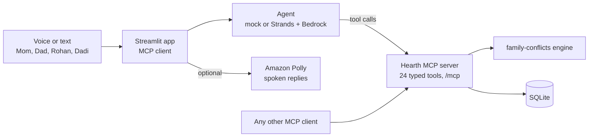

# Hearth

**The family calendar that talks back and catches problems before they happen.**

[](https://github.com/your-real-username/hearth/actions/workflows/ci.yml)


Hearth is a self-hosted **MCP server** and **Agent Skill** that lets a whole family manage plans by voice or text,
enforces the family's own rules, and fixes clashes with one tap. Built for the Alexa+ track of the Amazon hackathon.

<!-- Add a screenshot or GIF here:  -->

## The problem

Every family has one person who holds the whole week in their head: who has a meeting, who can pick up the kids,
which grandparent can't do evenings. Shared calendars store events but never notice that Mom and Dad are both busy
when a child needs an adult. Hearth notices, explains why, and offers a fix.

## What it does

- **Natural language in, typed tools out.** "Tuesday gym at 7, Wednesday tuition 6 to 7" becomes real events through MCP tools.
- **Deterministic conflict engine.** Person clashes, coverage clashes (a child's event needs an adult) and rule
  violations are found by plain code, each with a plain-English *why*. The model never decides conflicts.
- **Learned family rules.** "Dadi can't do evening pickups" is saved and enforced on later plans.
- **Fixes with Undo.** Ranked options, a confirm card, one-tap Undo. Nothing changes without confirmation.
- **Ask a person.** A clash can be fixed by asking a free family member (e.g. Dadi), who accepts or declines.
- **Proactive Week Guard**, bulk add, an approval inbox for kids' events, circular import from pasted text,
  fair chores with the reason, and a planning-load report.

> **What is simulated:** there is no real Alexa+ device (Alexa+ tooling is partner-only). The web app acts as the MCP
> client, and the speaker chips (Mom, Dad, Rohan, Dadi) simulate voice profiles.
> The model never touches the database. Only the MCP tools do.

## Architecture



## Quick start

Requires Python 3.10+.

```bash
python -m venv .venv
source .venv/bin/activate            # Windows PowerShell: .venv\Scripts\Activate.ps1
pip install -e .
cp .env.example .env                 # Windows: copy .env.example .env
python run.py                        # MCP server :8765 + app http://localhost:8501
```

`LLM_PROVIDER=mock` (the default) works offline with no AWS account.

| Command | What it does |
|---|---|
| `python run.py` | Seeds demo data, starts the MCP server and the app |
| `python run.py --server` | Starts only the MCP server |
| `python run.py --reset` | Wipes and re-seeds the database first |

Set `HEARTH_NOW=2026-10-20T10:00:00+05:30` in `.env` to pin "today" for a repeatable demo.

### Use it from another MCP client
Point any Streamable HTTP client at `http://127.0.0.1:8765/mcp` and load
[`skills/family-coordinator`](skills/family-coordinator/SKILL.md) so the agent uses the tools well.

### Live Bedrock and Polly
Set `LLM_PROVIDER=bedrock`, `AWS_REGION` and `BEDROCK_MODEL` in `.env`, with AWS credentials configured and model
access enabled. Turn on "Speak replies" in the app sidebar. See [docs/aws_integration.md](docs/aws_integration.md).

## MCP tools (24)

| Area | Tools |
|---|---|
| Family | `list_members`, `family_summary`, `planning_load` |
| Events | `add_event`, `add_events_bulk`, `list_events`, `move_event`, `delete_event`, `find_free_slot` |
| Conflicts and fixes | `detect_conflicts`, `suggest_resolutions`, `commit_action`, `undo_last`, `week_guard` |
| Rules | `add_rule`, `list_rules`, `remove_rule` |
| Asking and approving | `ask_member`, `respond_request`, `list_pending_approvals`, `approve_event` |
| Chores | `assign_chore`, `complete_chore`, `list_chores` |

## Demo (under 3 minutes)
1. Mom: *"Tuesday gym at 7, Wednesday tuition 6 to 7, Friday Nani's birthday dinner"* -> three events.
2. Mom: *"Rohan's PTM is Thursday at 5 at school"*. Switch to Dad: *"I have a client call Thursday 5 to 6"* -> clash card.
3. **What can we do?** -> **Ask Dadi** -> switch to Dadi -> **Yes, I'll go** -> clash gone, **Undo** shown.
4. Mom: *"Dadi can't do evening pickups"*, then *"Dadi will pick up Rohan from tuition Friday at 6"* -> rule enforced.
5. *"Any risks next week?"* -> Week Guard. Open **Under the hood** for the raw MCP traffic.

The full talk track is in [docs/demo_script.md](docs/demo_script.md).

## Tests

```bash
pip install -e ".[dev]"
pytest                      # 49 tests: engine, every MCP tool over real HTTP, golden demo, Ask-Dadi loop, Strands path, cards, lanes, .ics
python -m evals.run         # utterance -> tool eval (mock). Add --live for Bedrock
ruff check .
```

The Strands test runs the real Strands loop and Strands' MCP client against the real server with a stub model.
Mock-mode eval pass rates show the plumbing works; they are **not** a measure of model accuracy. Run `--live` for that.

## Project layout
```
packages/family_conflicts/   open-source conflict engine (MIT)
server/                      MCP server, SQLite models, services, seed
app/                         Streamlit UI, agent (mock | Strands+Bedrock | Converse), voice, MCP client
skills/family-coordinator/   Agent Skill
tests/  evals/               unit, integration and utterance evals
docs/                        AWS integration, demo script, judge Q&A, design notes (docs/kiro)
```

## Design notes
- Times are stored in UTC and shown in the family timezone (default Asia/Kolkata). Intervals are half-open.
- An event that needs an adult is covered if an adult attends it or a parent is free. If both parents are busy, the
  clash is reported and the fixes are ranked: move a parent's flexible event (keeping a 30 minute travel gap after a
  fixed event with a location), or ask a free adult such as Dadi to attend.
- If no end time or duration is given, one hour is assumed and the card says so.
- Child-created events wait in the approval inbox; children can't change adults' events.

## Roadmap
- Real Alexa+ skill once partner tooling is available
- Google Calendar / iCal sync
- Multi-household support and per-member notifications

## License

MIT. Built by [Pooja Jharani](https://github.com/your-real-username), 2026.
